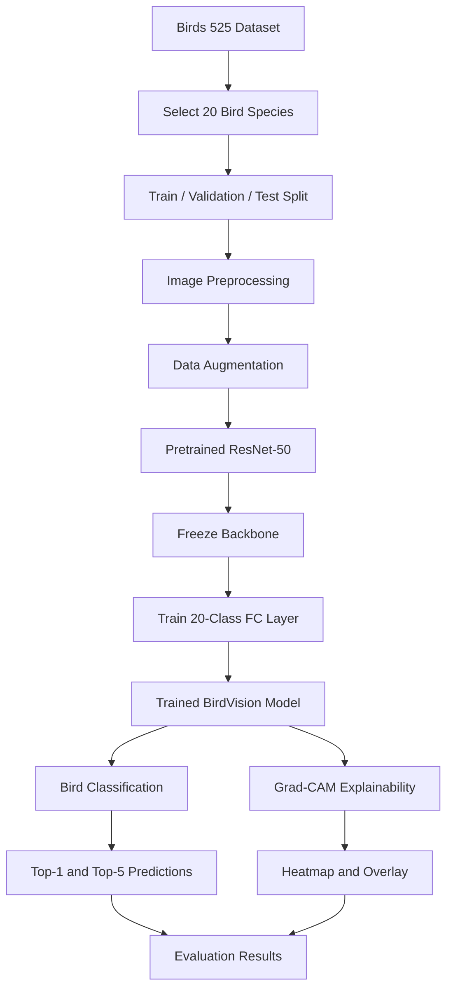

# BirdVision AI - Deep Learning Identification of Bird Species

## Project Overview

BirdVision AI is a deep learning-based bird species identification system designed to classify bird images into 20 different species.

The project uses transfer learning with a pretrained ResNet-50 architecture and PyTorch. It also integrates Grad-CAM (Gradient-weighted Class Activation Mapping) to visualize the image regions that contribute to the model's predictions.

The objective is to support biodiversity monitoring by making bird species identification more accessible and interpretable.

## Key Features

- Classification of 20 bird species.
- Transfer learning using pretrained ResNet-50.
- Data augmentation to improve model generalization.
- Top-1 and Top-5 prediction results.
- Grad-CAM-based visual explainability.
- Prediction on individual input images.
- Visualization of model attention regions.
- CPU-based inference without paid APIs or services.

## Technology Stack

| Component | Technology |
|---|---|
| Programming Language | Python 3.10 |
| Deep Learning Framework | PyTorch |
| Model Architecture | ResNet-50 |
| Computer Vision | Torchvision, OpenCV |
| Image Processing | Pillow |
| Data Analysis | NumPy, Pandas |
| Visualization | Matplotlib, Seaborn |
| Explainable AI | Grad-CAM |
| Development Environment | VS Code |

## Dataset

**Dataset:** Birds 525 Species Image Classification

**Source:** [Hugging Face - Birds 525 Species](https://huggingface.co/datasets/yashikota/birds-525-species-image-classification)

### Original Dataset Statistics

| Split | Images | Species |
|---|---:|---:|
| Training | 84,635 | 525 |
| Validation | 2,625 | 525 |
| Testing | 2,625 | 525 |
| **Total** | **89,885** | **525** |

For this project, 20 bird species were selected from the original dataset and extracted into a separate processed dataset.

### Selected Dataset Statistics

| Split | Images |
|---|---:|
| Training | 4,178 |
| Validation | 100 |
| Testing | 100 |
| **Total** | **4,378** |

The original raw dataset remains unchanged.

### Selected Bird Species

1. House Finch
2. Ovenbird
3. Asian Green Bee Eater
4. Wood Duck
5. Caspian Tern
6. Wood Thrush
7. Merlin
8. Oyster Catcher
9. Laughing Gull
10. Eastern Yellow Robin
11. Jacobin Pigeon
12. Dark Eyed Junco
13. Red Tailed Hawk
14. Yellow Breasted Chat
15. Violet Backed Starling
16. Violet Green Swallow
17. Limpkin
18. Red Knot
19. Sora
20. Grey Headed Chachalaca

## Model Architecture

BirdVision AI uses a pretrained ResNet-50 architecture with transfer learning.

- Loads pretrained ImageNet weights.
- Freezes the pretrained backbone.
- Replaces the final fully connected layer with a 20-class classification layer.
- Trains the classification head using the selected bird dataset.

### BirdVision AI Workflow



### Training Configuration

| Parameter | Configuration |
|---|---|
| Architecture | ResNet-50 |
| Input Image Size | 224 x 224 |
| Batch Size | 16 |
| Epochs | 10 |
| Optimizer | AdamW |
| Learning Rate | 0.001 |
| Weight Decay | 0.01 |
| Loss Function | Cross Entropy Loss |
| Device | CPU |

### Data Augmentation

The following transformations are applied during training:

- Random Resized Crop
- Random Horizontal Flip
- Random Rotation
- Color Jitter
- ImageNet Normalization

Validation and test images use deterministic resizing, center cropping and ImageNet normalization.

## Model Evaluation

The trained model was evaluated using the held-out test dataset.

### Evaluation Results

| Metric | Result |
|---|---:|
| Top-1 Accuracy | 96.00% |
| Top-5 Accuracy | 100.00% |
| Test Images | 100 |

The model correctly classified 96 out of 100 test images.

**Important limitation:** The validation and test sets contain only five images per species. Therefore, these accuracy results are preliminary and should not be treated as robust estimates of real-world performance.

### Evaluation Artifacts

The project generates:

- Accuracy curve
- Loss curve
- Confusion matrix
- Classification report
- Misclassification report

## Explainable AI - Grad-CAM

Grad-CAM (Gradient-weighted Class Activation Mapping) is used to visualize the image regions that contribute to the model's classification decision.

The system generates three visual outputs:

1. Original bird image.
2. Grad-CAM heatmap.
3. Grad-CAM overlay.

These visualizations help inspect which regions influence the model's prediction.

## Prediction System

BirdVision AI supports predictions on individual bird images.

The prediction system provides:

- Predicted bird species.
- Prediction confidence.
- Top-5 species predictions.
- Grad-CAM visualization.
- Prediction report.

### Example Prediction

| Output | Result |
|---|---|
| Input Image | new_bird.jpg |
| Predicted Species | WOOD DUCK |
| Confidence | 98.76% |

**Note:** Softmax confidence represents the model's relative prediction score. It is not a guarantee of real-world accuracy.

### Prediction Output

Generated files:

- `new_bird_prediction.png`
- `new_bird_report.txt`

Output directory:

```text
results/predictions/unseen/
```

## Project Structure

```text
BirdVision-AI/
│
├── config/
│   └── selected_species.txt
│
├── dataset/
│   ├── raw/
│   │   └── birds_525/
│   └── processed/
│       └── birds_20/
│           ├── train/
│           ├── validation/
│           └── test/
│
├── input_images/
│   └── new_bird.jpg
│
├── models/
│   ├── best_resnet50.pth
│   └── training_history.pth
│
├── notebooks/
│
├── results/
│   ├── confusion_matrix/
│   ├── gradcam_images/
│   ├── predictions/
│   ├── accuracy_curve.png
│   ├── loss_curve.png
│   ├── confusion_matrix.csv
│   ├── class_names.txt
│   └── evaluation_report.txt
│
├── src/
│   ├── analyze_misclassifications.py
│   ├── data_transforms.py
│   ├── dataset.py
│   ├── evaluate.py
│   ├── explore_dataset.py
│   ├── gradcam.py
│   ├── model.py
│   ├── plot_confusion_matrix.py
│   ├── plot_training_history.py
│   ├── predict.py
│   ├── prepare_selected_dataset.py
│   ├── species_distribution.py
│   ├── train.py
│   └── training_config.py
│
├── download_dataset.py
├── requirements.txt
├── README.md
└── .gitignore
```

**Note:** The dataset and trained model checkpoints are kept locally and excluded from the GitHub repository through `.gitignore`.

## Installation and Setup

### 1. Clone the Repository

```bash
git clone https://github.com/basireddy-methasree/BirdVision-AI.git
cd BirdVision-AI
```

### 2. Create a Virtual Environment

```bash
python -m venv .venv
```

Activate the environment on Windows PowerShell:

```powershell
.\.venv\Scripts\Activate.ps1
```

### 3. Install PyTorch CPU Version

```powershell
python -m pip install torch==2.6.0 torchvision==0.21.0 --index-url https://download.pytorch.org/whl/cpu
```

### 4. Install Remaining Dependencies

```powershell
python -m pip install -r requirements.txt
```

### 5. Prepare the Dataset

Download the original dataset using the provided dataset download script:

```powershell
python download_dataset.py
```

The dataset should be available under:

```text
dataset/raw/birds_525/
```

The processed dataset is stored under:

```text
dataset/processed/birds_20/
```

### 6. Run Bird Prediction

Place an input bird image inside `input_images/`.

Run:

```powershell
python src/predict.py
```

The system generates the prediction visualization and report under:

```text
results/predictions/unseen/
```

**Model checkpoint requirement:** The trained checkpoint `models/best_resnet50.pth` must also be available locally before running prediction. It is not included in the GitHub repository.

## Future Enhancements

- Expand classification to more bird species.
- Improve model generalization using larger validation and test datasets.
- Develop a web-based interface for image uploads.
- Explore deployment on edge devices for biodiversity monitoring.

## Project Objective

BirdVision AI demonstrates how deep learning and explainable AI can be combined to build an interpretable bird species classification system that can contribute to biodiversity monitoring research.

## Dataset Attribution

The dataset is sourced from the Hugging Face dataset:

[yashikota/birds-525-species-image-classification](https://huggingface.co/datasets/yashikota/birds-525-species-image-classification)

Please refer to the original dataset page for its licensing and attribution requirements.

This project is developed for academic and educational purposes.